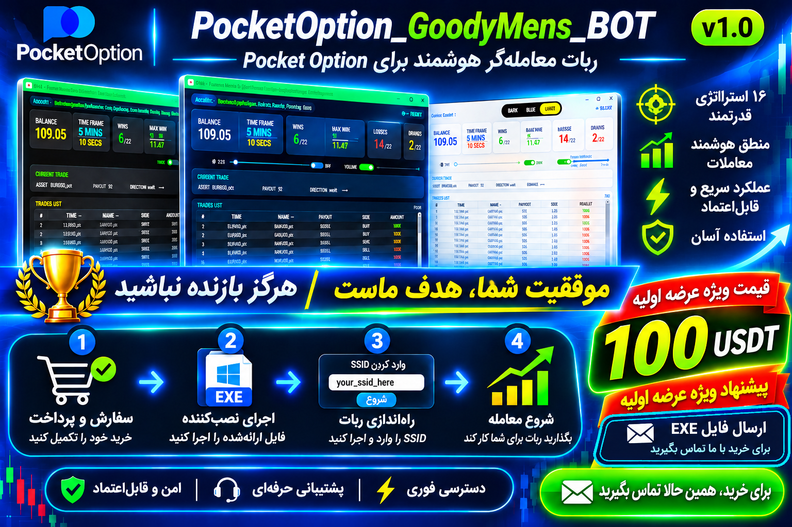

# PocketOption GoodyMens BOT نسخه 1.0

**ربات معامله‌گر هوشمند برای Pocket Option**

به صفحه رسمی معرفی ربات PocketOption GoodyMens BOT خوش آمدید!

## 🚀 امکانات ربات

- ۱۶ استراتژی معاملاتی
- منطق هوشمند معاملات
- عملکرد سریع
- رابط کاربری مدرن
- استفاده آسان

## 💰 قیمت ویژه عرضه اولیه

# 100 USDT

قیمت عرضه اولیه محصول: ۱۰۰ تتر

## 📦 مواردی که دریافت می‌کنید

- نرم‌افزار PocketOption GoodyMens BOT نسخه 1.0
- فایل اجرایی EXE
- راهنمای نصب
- راهنمای تنظیم SSID

## ⚙️ راهنمای نصب و راه‌اندازی

۱. خرید محصول را تکمیل کنید.

۲. فایل EXE را از طریق ایمیل دریافت کنید.

۳. فایل نصب را اجرا کنید.

۴. SSID خود را وارد کنید.

۵. ربات را اجرا کنید.

## 🛒 نحوه خرید

۱. از طریق ایمیل با ما تماس بگیرید.

۲. اطلاعات پرداخت را دریافت کنید.

۳. پرداخت خود را با تتر (USDT) انجام دهید.

۴. پس از تأیید پرداخت، فایل EXE از طریق ایمیل برای شما ارسال خواهد شد.

## 📩 ارتباط با ما

**ایمیل فروش و پشتیبانی:**

arazeskandarian@gmail.com

برای خرید محصول و دریافت پشتیبانی فنی از طریق ایمیل با ما در ارتباط باشید.

## ⚠️ هشدار ریسک معاملات

معاملات مالی همواره با ریسک همراه هستند.

هیچ ربات یا استراتژی معاملاتی نمی‌تواند سود را تضمین کند یا از تمام زیان‌ها جلوگیری کند.

عملکرد گذشته تضمینی برای نتایج آینده نیست.

از نرم‌افزار با مسئولیت‌پذیری استفاده کنید.

---

**نام محصول:** PocketOption GoodyMens BOT

**نسخه:** 1.0

**قیمت:** 100 USDT
---
## 👨‍💻 توسعه‌دهنده و برنامه‌نویس

طراحی و برنامه‌نویسی توسط: **شهروز اسکندریان**

با ۱۰ سال تجربه در توسعه استراتژی‌های معاملاتی و تبدیل آن‌ها به ربات‌های خودکار.
